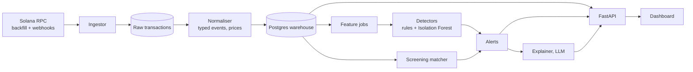

# ChainScope

A Solana data and intelligence platform. ChainScope ingests wallet and transaction data, normalises it, profiles how wallets behave, flags anomalies, and explains each flag in plain language with the transactions behind it.

> **Status:** in design (Nov 2026). This README is the build plan; sections fill in as each phase ships.

## What it does

| Feature | Detail |
|---|---|
| **Track** | Add a wallet or program; ChainScope backfills its history and streams new activity |
| **Normalise** | Raw transactions become typed events: transfers, swaps and program calls, with USD values |
| **Profile** | Activity over time, counterparties, token mix and behaviour features per wallet |
| **Graph** | Who sent what to whom, as an explorable flow graph |
| **Detect** | Volume spikes, new-counterparty bursts, peel chains and mixer-like patterns |
| **Screen** | Counterparties matched against published sanctioned address lists |
| **Explain** | Every flag comes with a plain-language reason that cites its transactions |

## Architecture

## Phases

- [ ] **1. Ingest and normalise:** backfill, streaming, idempotent writes, typed events
- [ ] **2. Profiles and API:** wallet features, flow graph, FastAPI endpoints
- [ ] **3. Detection:** anomaly detectors, screening, explained alerts
- [ ] **4. Dashboard and deploy**

## Evals

- Synthetic anomalies injected into real history: precision and recall per detector
- Explanation faithfulness: every number in an explanation must match the data

## Scope and limits

ChainScope tracks a chosen set of wallets and programs, not the whole chain. It reads public chain data only and never holds keys or funds. A flag is a prompt to look closer, not an accusation.

## Stack

Python · FastAPI · Postgres · DuckDB · scikit-learn · Claude API · Next.js · Docker · GitHub Actions

Architecture, repository structure and database plan: [docs/ARCHITECTURE.md](docs/ARCHITECTURE.md)

---
Mariyam Pangarkar · [LinkedIn](https://linkedin.com/in/mariyam-pangarkar) · [Portfolio](https://mariyampangarkar19.github.io)
