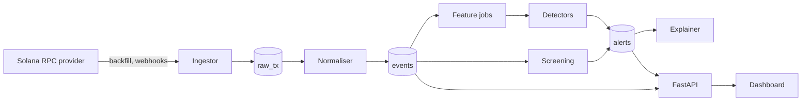

# ChainScope: architecture

Status: locked for v1 (Nov 2026). Changes go through a short decision record in `docs/decisions/`.

## Principles this design follows

1. **Separation of concerns.** HTTP handling, business logic, LLM calls and data access live in separate layers. A route never talks to the database or the model directly.
2. **Dependencies point inward.** `domain` knows nothing about FastAPI, Postgres or any LLM vendor. Outer layers (API, adapters) depend on inner ones, never the reverse.
3. **Ports and adapters.** Every external system (database, LLM, third-party API) sits behind a small interface, so it can be swapped or faked in tests.
4. **The LLM is an untrusted component.** Its output is validated by ordinary code before anything acts on it. Safety rules are enforced in code, not in prompts.
5. **Stateless services, state in the database.** Any process can be restarted or scaled without losing work.
6. **Idempotent writes.** Reprocessing the same input never creates duplicates.
7. **Observable by default.** Every request and every model or tool call is logged with latency and cost.
8. **Start as a modular monolith.** One deployable service with clear module boundaries; split out a service only when a real need appears.

## Technology decisions

| Layer | Choice | Why |
|---|---|---|
| Backend language | Python 3.12 | Data and ML tooling; shared with the other projects |
| API | FastAPI | Async, typed |
| Chain access | Solana RPC provider with parsed transactions and webhooks (Helius or similar), behind a `ChainSource` port | Avoids running a node; provider is swappable |
| Storage | PostgreSQL 16, raw table partitioned by month | Relational joins for counterparties; partitions keep the big table manageable |
| Analytics | DuckDB reading from Postgres for feature jobs | Fast columnar aggregates without another server |
| Jobs | A Postgres-backed queue with a worker process (`SELECT ... FOR UPDATE SKIP LOCKED`) | No extra infrastructure in v1 |
| Detection | Rules plus scikit-learn Isolation Forest | Explainable first, statistical second |
| Explanations | Claude API behind an `LLMClient` port | Writes reasons from computed features only |
| Frontend | TypeScript, Next.js, Tailwind, a force-graph library | Dashboard and flow graph |
| Delivery | Docker Compose (api, worker, db), GitHub Actions, a small VPS or Fly.io | One command to run everything |

## System context



The pipeline is a classic **raw, then clean, then derived** layout: raw data is kept exactly as received, so the normaliser can be fixed and rerun without re-fetching anything.

## Repository structure

```
chainscope/
  backend/
    app/
      api/            # routers: wallets, graph, alerts, screen
      domain/         # Event, WalletProfile, Alert, detector interfaces
      ingest/         # backfill.py, webhook.py, cursor handling
      normalise/      # one parser per transaction kind (transfer, swap, program call)
      features/       # per-wallet feature jobs
      detect/         # rules/, isolation_forest.py, screening.py
      explain/        # prompt + number-check
      adapters/
        chain/        # ChainSource port + provider implementation + fixture replay
        prices/       # PriceSource port
        llm/
        repo/
      jobs/           # queue, worker, schedules
      core/
    migrations/
    tests/            # fixtures of real transactions; replay tests
  frontend/
  evals/              # synthetic anomaly injection, precision/recall
  docs/
  infra/
```

## Database plan

```sql
CREATE TABLE wallets (
  address       text PRIMARY KEY,            -- base58
  label         text,
  kind          text NOT NULL DEFAULT 'wallet' CHECK (kind IN ('wallet','program','exchange')),
  tracked       boolean NOT NULL DEFAULT false,
  tracked_since timestamptz,
  backfill_cursor text                       -- last signature processed
);

CREATE TABLE raw_tx (                        -- exactly what the provider returned
  signature     text NOT NULL,
  slot          bigint NOT NULL,
  block_time    timestamptz NOT NULL,
  payload       jsonb NOT NULL,
  ingested_at   timestamptz NOT NULL DEFAULT now(),
  PRIMARY KEY (signature, block_time)
) PARTITION BY RANGE (block_time);           -- one partition per month

CREATE TABLE tokens (
  mint          text PRIMARY KEY,
  symbol        text,
  decimals      smallint NOT NULL
);

CREATE TABLE events (                        -- one row per value movement
  id            bigserial PRIMARY KEY,
  signature     text NOT NULL,
  ix_index      smallint NOT NULL,           -- position inside the transaction
  kind          text NOT NULL CHECK (kind IN ('transfer','swap','program_call')),
  from_address  text,
  to_address    text,
  mint          text REFERENCES tokens(mint),
  amount        numeric(38,0) NOT NULL,      -- raw units; never floats
  usd_value     numeric(20,4),
  program_id    text,
  block_time    timestamptz NOT NULL,
  UNIQUE (signature, ix_index)               -- makes reprocessing idempotent
);
CREATE INDEX ON events (from_address, block_time DESC);
CREATE INDEX ON events (to_address, block_time DESC);

CREATE TABLE wallet_features (
  address       text NOT NULL REFERENCES wallets(address),
  window_start  timestamptz NOT NULL,
  window_size   interval NOT NULL,
  features      jsonb NOT NULL,              -- volume, counterparties, velocity, token mix
  PRIMARY KEY (address, window_start, window_size)
);

CREATE TABLE sanctioned_addresses (
  address       text PRIMARY KEY,
  source        text NOT NULL,
  listed_at     date
);

CREATE TABLE alerts (
  id            uuid PRIMARY KEY DEFAULT gen_random_uuid(),
  address       text NOT NULL REFERENCES wallets(address),
  detector      text NOT NULL,
  score         numeric(6,4) NOT NULL,
  evidence      jsonb NOT NULL,              -- signatures and the feature values that fired
  explanation   text,
  status        text NOT NULL DEFAULT 'open' CHECK (status IN ('open','dismissed','confirmed')),
  created_at    timestamptz NOT NULL DEFAULT now()
);
CREATE INDEX ON alerts (address, created_at DESC);

CREATE TABLE jobs (
  id            bigserial PRIMARY KEY,
  kind          text NOT NULL,
  payload       jsonb NOT NULL,
  status        text NOT NULL DEFAULT 'queued',
  attempts      smallint NOT NULL DEFAULT 0,
  run_after     timestamptz NOT NULL DEFAULT now()
);
```

Rules: token amounts are stored as integers in raw units; `UNIQUE (signature, ix_index)` and upserts make every stage safe to rerun; `raw_tx` partitions older than the retention window can be dropped or archived to Parquet.

## API

| Method and path | Purpose |
|---|---|
| `POST /wallets` | Track an address and queue its backfill |
| `GET /wallets/{address}/profile` | Features and activity over time |
| `GET /wallets/{address}/graph?depth=` | Counterparty flow graph |
| `GET /alerts`, `PATCH /alerts/{id}` | List, dismiss or confirm |
| `POST /screen` | Check addresses against the sanctions list |
| `POST /webhooks/chain` | Provider webhook, signature verified |

## Key decisions

- **Tracked set, not the whole chain.** Full indexing needs infrastructure this project does not need to prove its point.
- **Keep raw data.** Parsers will be wrong at first; replaying from `raw_tx` is cheaper than re-fetching.
- **The explainer never computes.** It receives computed features and may only restate them; a check rejects any number not in its input.
